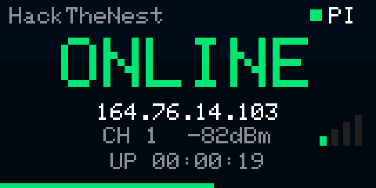
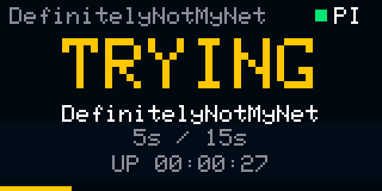
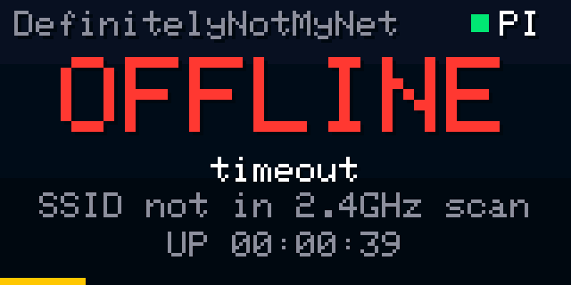

# T-Dongle-S3 Wi-Fi status panel (headless Raspberry Pi 5 display)

The Pi 5 has no monitor attached and no micro-HDMI adapter on hand, so this
dongle is the display: plug it into the Pi's USB port and it tells you, on its
own LCD, whether the Pi is up and whether the network link is good.

Firmware for the LilyGo T-Dongle-S3 (ESP32-S3, 16 MB flash, no PSRAM). It runs
from flash on any 5 V source - nothing is installed or executed on the Pi.

## What the screen says

| Screen | Meaning |
|---|---|
|  | `ONLINE` - associated and has an IP. Shows IP, channel, RSSI and signal bars. |
|  | `TRYING` - joining, with elapsed time against the 15 s budget. |
|  | `OFFLINE` - failure cause plus whether the SSID was visible in the 2.4 GHz scan. Retries with backoff (3 s doubling to 30 s). |

Permanent elements:

- **Top left** - SSID being joined.
- **Top right** - `PI`: the dongle only sees a USB host once it is enumerated, so a
  lit box means the Pi's kernel is running and has claimed the USB port. On a wall
  charger or a Pi that is powered but not booted, it stays dark.
- **Bottom** - `UP HH:MM:SS` since the dongle was powered, and a one-second sweep
  bar that proves the firmware has not hung (it stops moving if the loop stalls).
- **LED** - green when online, amber while trying, red when offline.

## Wiring / panel notes

| Signal | GPIO | Notes |
|---|---|---|
| LCD SCLK / MOSI / CS / DC / RST | 5 / 3 / 4 / 2 / 1 | |
| LCD backlight | 38 | **active low**, `ledcWrite(38, 255 - level)` |
| APA102 DI / CI | 40 / 39 | BGR, single LED |

Panel init is `INITR_MINI160x80_PLUGIN` (col 26 / row 1 offsets, inverted, BGR) -
the same thing LilyGo's `esp_lcd` driver does.

## Build and flash

```sh
cp secrets.h.example tdongle_wifi/secrets.h   # then edit
./flash.sh
```

`flash.sh` compiles, uploads, and then pulls a live framebuffer off the device into
`screen.png`, so you can see what the glass is showing without looking at it.

## Credentials

`tdongle_wifi/secrets.h` holds the SSID and password and is gitignored. The
fallback defines in the sketch keep the repo building without it. Note that the
credentials are still readable from the device with `esptool read_flash`, so treat
a flashed dongle as holding that password.

## Serial interface

The dongle appears as `/dev/ttyACM0` on the Pi (and on any Linux host). It emits
JSON events and answers a frame-dump request:

```
{"event":"boot"}
{"event":"online","ip":"164.76.14.103","rssi":-82,"ch":1,"ms":4123}
{"event":"status","rssi":-82,"ch":1,"up":19}
{"event":"fail","status":1,"ssidSeen":0}
```

Send `d` to receive the current frame as base64 RGB565 between `FBEGIN <bytes>`
and `FEND` - decode with `decode_frame.py`.

## Restoring the factory firmware

The full 16 MB dump taken before the first flash is `original_factory_16MB.bin`
(gitignored, kept locally):

```sh
esptool --port /dev/ttyACM0 write_flash 0x0 original_factory_16MB.bin
```

LilyGo's stock demo is also published in their repo as
`firmware/T-Dongle-S3_factory_screen_*.bin`.

## Caveats

- The ESP32-S3 radio is **2.4 GHz only**. If a router advertises the same SSID on
  both bands, this joins the 2.4 GHz one. A 5 GHz-only SSID shows as
  `no 2.4GHz AP`.
- Association + DHCP lands in roughly 3-6 s; the screen is live throughout.
- Weak signal shows up directly as the bar count and dBm. Below about -80 dBm the
  link may drop and rejoin; that is the AP's coverage, not the firmware.
